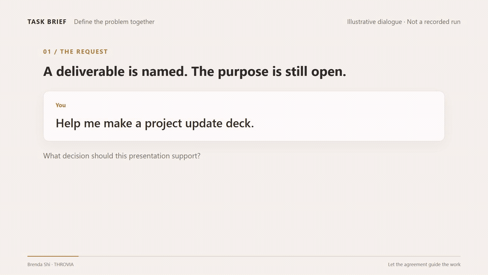

<p align="center">
  
</p>

<p align="center"><a href="#why">Why Task Brief</a> · <a href="#demo">Demo</a> · <a href="#start">Quick start</a> · <a href="#examples">Examples</a> · <a href="#faq">FAQ</a> · <a href="README.zh-CN.md">简体中文</a></p>

You have a task in mind, but why it matters, what to solve first, and how far to go may still be unclear. Task Brief asks AI to help make those judgments: check for gaps and question the approach, explain differences in understanding, then agree with you on the goal, scope and completion criteria.

**Open-source skill** · **Codex · Claude Code** · **Skill-compatible agents** · **MIT · skill & documentation**

<a id="why"></a>

## AI shares responsibility for defining the problem

Task Brief turns shared judgment, disagreement handling and agreed decisions into reusable rules, so the responsibility for clarification does not fall entirely on you.

| Responsibility | Expected behavior |
| --- | --- |
| Contribute judgment | Find omissions and check whether the approach serves the goal; explain concerns and suggest alternatives. |
| Expose disagreements | Distinguish the user's request, the AI's interpretation, and their practical differences. |
| Calibrate scope | Define the subject, depth, stopping point and deliverable for this round. |
| Make progress | Resolve uncertainty or obtain a needed decision. Limit alignment to four rounds; retain unresolved issues. |
| Honor agreements | Carry confirmed decisions forward, disclose changes, and proceed only with clear, authorized work. |

<details open>
<summary>The full design intent</summary>

AI should share responsibility for defining the problem: proactively surface blind spots, check whether proposed approaches serve the goal, make differences in understanding and key disagreements explicit, jointly determine what to solve and to what depth, and use established agreements as the basis for further work.

</details>

<a id="demo"></a>

## From “make a deck” to “help leadership make a decision”



Looping GIF · English · Illustrative dialogue, not a recorded run. Read the dialogue below at your own pace. [Download the full MP4 (48 seconds)](https://github.com/THROVIA/Task_Brief/raw/refs/heads/main/assets/demo/task-brief-en.mp4)

<details open>
<summary>Read the illustrative dialogue in English</summary>

**You:** Help me make a project update deck.

**AI:** The materials mention a staffing shortage. Is the goal to get more people?

**You:** Leadership may not approve that. I need them to decide which of two tasks takes priority.

**AI:** Then the deck should help leadership decide task priority. Let’s use that to choose the material.

</details>

**01 / OFFER A JUDGMENT · AI helps uncover what is missing**

It makes its “short staffing → request more people” assumption explicit, so you can confirm or correct it.

**02 / SURFACE THE DIFFERENCE · Define the current problem together**

You explain the constraint: what you need now is a decision on task priority.

**03 / GUIDE THE NEXT STEP · Use the agreement as the basis for the work**

Once you confirm the direction, choose material about task impact, capacity and trade-offs.

This example shows how the understanding of a problem can change. It does not establish that a model will always find blind spots, or show the business outcome of the presentation.

<a id="start"></a>

## Get started

### 1. Install in your AI tool

Choose your tool below. The [Skills CLI](https://github.com/vercel-labs/skills) requires Node.js 22.20 or later. Commands with `-g` install for personal use; omit it to install in the current project.

<details open>
<summary>Codex</summary>

```sh
npx skills add THROVIA/Task_Brief --skill task-brief -a codex -g
```

In Codex CLI or the IDE extension, select the skill with `/skills` or mention `$task-brief`.

[Official skill documentation](https://learn.chatgpt.com/docs/build-skills)

</details>

<details open>
<summary>Claude Code</summary>

```sh
npx skills add THROVIA/Task_Brief --skill task-brief -a claude-code -g
```

Start with `/task-brief` in Claude Code chat.

[Official skill documentation](https://code.claude.com/docs/en/skills)

</details>

<details>
<summary>Cursor</summary>

```sh
npx skills add THROVIA/Task_Brief --skill task-brief -a cursor -g
```

Use `/task-brief` or select it with `@` in Agent chat. A local install is not automatically available to remote workers; Cloud Agents need skill sync or project skills.

[Official skill documentation](https://cursor.com/help/customization/skills)

</details>

<details>
<summary>Gemini CLI</summary>

```sh
npx skills add THROVIA/Task_Brief --skill task-brief -a gemini-cli -g
```

Run `/skills reload`, then check `/skills list`. Ask Gemini to use `task-brief` for your task and follow its activation prompt. This applies to Gemini CLI, not the Gemini web chat.

[Official skill documentation](https://geminicli.com/docs/cli/using-agent-skills/)

</details>

<details>
<summary>OpenCode</summary>

```sh
npx skills add THROVIA/Task_Brief --skill task-brief -a opencode -g
```

Ask the agent to load the `task-brief` skill for your task. Skill discovery and access follow your OpenCode permissions.

[Official skill documentation](https://opencode.ai/docs/skills/)

</details>

Cursor, Gemini CLI and OpenCode instructions follow their documented Skill support. Task Brief has not been tested end to end on these three clients; loading and behavior can vary by client version and model.

<details>
<summary>Manual installation and other agents</summary>

Download <SKILL.md> and save it at the path for your tool. Keep the filename and frontmatter intact. `~` means your user home directory.

| Tool | Personal installation path |
| --- | --- |
| Codex | `~/.agents/skills/task-brief/SKILL.md` |
| Claude Code | `~/.claude/skills/task-brief/SKILL.md` |
| Cursor | `~/.cursor/skills/task-brief/SKILL.md` |
| Gemini CLI | `~/.gemini/skills/task-brief/SKILL.md` |
| OpenCode | `~/.config/opencode/skills/task-brief/SKILL.md` |

Reopen the client or reload its skills. For more agents, use the [Skills CLI agent list](https://github.com/vercel-labs/skills/blob/main/docs/agents.md) to find the matching installer target.

</details>

### 2. Bring a task you are working on

After invoking the skill, try this:

```
I need a project update deck for leadership.
We have two tasks to deliver and too few people.
Help me work out what this presentation needs to achieve,
then agree with me on which material to include.
```

Bring any decisions already made. A useful conversation should expose a consequential gap or choice, clarify the work ahead, and retain what you have already settled.

<a id="examples"></a>

## Example scenarios

Illustrative starting points for your own tasks.

### Build a signup page

“Build a volunteer signup page. It is free, with a maximum of 30 participants.”

Does registration reserve a place, or is approval required? That decision changes the flow, the participant status, and what happens when places run out.

Agree on the admission rule before building the form.

### Investigate a drop in inquiries

“Analyze three months of inquiry records. Some source labels are missing.”

Are you deciding where to invest, or checking where inquiries were lost? Missing labels may limit channel-level conclusions.

Define the decision the analysis must support and what the records can establish.

### Improve a product page

“Make this product page more convincing.”

Who is reading it, and what should they do next? A page for first-time visitors needs a different argument from one for experienced users.

Agree on the audience and next action before changing the copy.

<a id="faq"></a>

## FAQ

<details open>
<summary>How does it compare with grill-me and brainstorming?</summary>

All three help you think before acting. Choose by what you want the conversation to produce.

| Skill | Use it when you want to… | Main emphasis |
| --- | --- | --- |
| [grill-me / grilling](https://github.com/mattpocock/skills/tree/main/skills/productivity/grill-me) | Stress-test a plan or decision. | Work through dependent decisions in interview rounds until the decision tree is covered, then confirm shared understanding. |
| [superpowers brainstorming](https://github.com/obra/superpowers/blob/main/skills/brainstorming/SKILL.md) | Develop an idea into a design. | Explore intent through questions, playback and, when helpful, visuals. Agree on a chat description or written design before proceeding. |
| **Task Brief** | Define the current problem and how far this round should go. | Explicitly handle blind spots, disagreements, scope and prior decisions. Check progress and cap alignment at four rounds, retaining unresolved choices. |

These are differences in emphasis, not exclusive capabilities. See the published [grilling](https://github.com/mattpocock/skills/blob/main/skills/productivity/grilling/SKILL.md) and [brainstorming](https://github.com/obra/superpowers/blob/main/skills/brainstorming/SKILL.md) instructions.

</details>

<details>
<summary>Does every task need a round of questions?</summary>

Simple, clear tasks can proceed directly. If the important decisions are already in the conversation, Task Brief reuses them. For an unclear task, each round should resolve something that matters; after at most four rounds, it summarizes agreements and open questions. Only clear, authorized work proceeds.

</details>

<details>
<summary>Will it override my judgment?</summary>

You keep the final decision. AI should explain why an approach may miss the goal, describe the trade-off, and offer a recommendation. Its suggestion does not become your decision until you accept it or have delegated that choice.

</details>

<details>
<summary>Can I use it in a regular AI chat?</summary>

Yes: paste the instructions from <SKILL.md> and ask the assistant to apply them to your task. This supplies instructions for that conversation; it does not install a native Skill. Follow the app’s import instructions if it offers Skills. Model behavior and context still matter.

</details>

<details>
<summary>Can I use it before another skill, or continue in a new chat?</summary>

Pass the agreed task, scope, deliverable, completion criteria and open questions to the next workflow. Ask it to retain those decisions and clarify only new issues. For a new chat, include this brief yourself; Task Brief does not create persistent memory across conversations.

</details>

<a id="feedback"></a>

## Share what changed

Did AI catch a blind spot, expose a disagreement, or help you choose the next step? Share a redacted exchange. Repeated questions and misunderstood goals are useful reports too.

- [Share feedback](https://github.com/THROVIA/Task_Brief/issues) with your task, the relevant response, and what happened next.
- [Star the project](https://github.com/THROVIA/Task_Brief) to find it again when you need it.
- [Follow Brenda / THROVIA](https://x.com/brenda_50555) for human–AI collaboration examples and project updates.

---


**Brenda Shi · THROVIA**

Published by 上海未见之地科技有限公司.

[SKILL.md](SKILL.md) · [Changelog](CHANGELOG.md) · [MIT License](LICENSE) · [Brand usage](BRAND_USAGE.md)

Skill instructions and documentation use the MIT license. Names, logos and brand images are covered by the separate brand usage notice.

Copyright (c) 2026 Brenda Shi · THROVIA.
