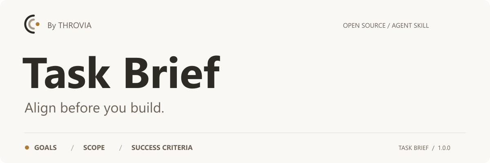

<p align="center">
  
</p>

<p align="center">
  <a href="#quick-start">Quick start</a> &nbsp;·&nbsp;
  <a href="#in-practice">Usage example</a> &nbsp;·&nbsp;
  <a href="#how-it-works">How it works</a> &nbsp;·&nbsp;
  <a href="README.zh-CN.md">简体中文</a>
</p>

<p align="center"><strong>Clear goals. Defined scope. Shared success criteria.</strong><br>
An agent skill for aligning with AI before complex work.</p>

---

AI can start producing an answer before you have agreed on what to solve. Task Brief helps you clarify intent, surface overlooked questions and disagreements, and agree on the deliverable before planning, writing, analysis, or development.

**Simple tasks stay simple. Already aligned work moves forward.** A brief records the agreement; filling out a template is not the goal.

## Quick start

Install for **Claude Code** with Node.js and npm available:

```sh
npx skills add THROVIA/Task_Brief --skill task-brief -a claude-code
```

Follow the installer prompts, then try:

```text
/task-brief Before coding, help me clarify the requirements for a volunteer signup page. I have not decided whether applications need approval.
```

<details>
<summary><strong>Prefer a manual installation?</strong></summary>

1. Download this repository using **Code → Download ZIP** and extract it.
2. Rename the extracted folder containing `SKILL.md` to `task-brief` if needed.
3. Copy that folder into your project's `.claude/skills/` directory. The skill entry point should be `.claude/skills/task-brief/SKILL.md`.
4. Open Claude Code in the project and use the prompt above.

For personal use across projects, place the folder in `~/.claude/skills/task-brief/` instead. Choose one installation location.

</details>

[Skills CLI documentation](https://github.com/vercel-labs/skills) · [Claude Code skill setup](https://code.claude.com/docs/en/skills)

## In practice

**You bring an idea:** “I need a volunteer signup page.”

**Task Brief helps make it actionable:**

| Before starting | What to clarify |
| :--- | :--- |
| Purpose | Who is signing up, and for which activity? |
| Scope | Is this just a signup page, or also an approval workflow? |
| Deliverable | Do you need a requirements brief, a prototype, or working code? |
| Success criteria | What observable result would make the work complete? |
| Open decisions | Do applications need approval, and who decides? |

*Illustrative example, not a fixed response or a completed decision.*

If you asked to clarify before coding, implementation waits. The outcome is a shared working definition with unresolved decisions visible. A confirmed definition and permission to execute are assessed separately.

## How it works

Six checks guide the conversation. They do not require six rounds of questions.

1. **Understand the intent.** Restate the task and purpose; check for omissions.
2. **Define the work.** Clarify the subject, scope, and deliverable.
3. **Check progress.** Resolve consequential gaps and obtain necessary confirmation.
4. **Surface disagreements.** Make incompatible requirements explicit.
5. **Establish the definition.** Clarify execution authorization and make changes visible.
6. **Conclude alignment.** Within four rounds for the same definition, retain unresolved matters and establish the next step.

Existing information and authorization are reused. Clear single-step actions are handled directly. The response follows your language.

Read the full [skill instructions](SKILL.md).

## Project guide

The repository root is the skill directory.

| File | Purpose |
| :--- | :--- |
| [SKILL.md](SKILL.md) | Skill instructions and discovery description |
| [README.zh-CN.md](README.zh-CN.md) | 中文安装与使用说明 |
| [CHANGELOG.md](CHANGELOG.md) | Version and packaging history |
| [LICENSE](LICENSE) | MIT license |
| [assets/](assets/) | README artwork and THROVIA brand assets |

## Feedback

[Open an issue](https://github.com/THROVIA/Task_Brief/issues) with your task, the response, and what helped or added friction. Include the client/model and how you invoked the skill. Remove private information before sharing.

Follow [Brenda Shi on X](https://x.com/brenda_50555) for human–AI collaboration and product practice. If Task Brief helps your work, a star helps others discover it.

---


Created by **Brenda Shi · THROVIA**. Published by **上海未见之地科技有限公司**.

AI-assisted preparation; human-directed design and release decisions.

Copyright (c) 2026 Brenda Shi · THROVIA. Licensed under the [MIT License](LICENSE).
