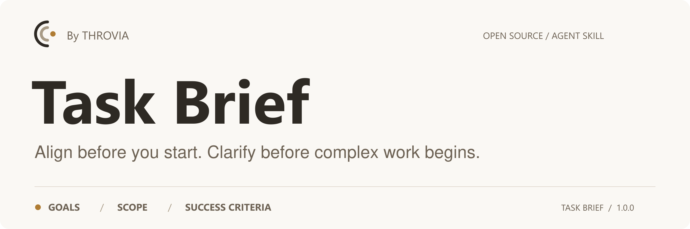

<p align="center">
  
</p>

<p align="center">
  <a href="#quick-start">Quick start</a> ·
  <a href="#more-ways-to-use-it">More examples</a> ·
  <a href="#why-task-brief">Why Task Brief</a> ·
  <a href="README.zh-CN.md">简体中文</a>
</p>

# Task Brief — Align before you start

**AI is ready to start. Are you solving the same problem?**

Task Brief is an open-source agent skill that helps you and AI uncover gaps, surface disagreements, and agree on scope, deliverables, and the next step. It reuses decisions already established in the current conversation.

Use it for planning, writing, analysis, document organization, or development, with **Codex, Claude Code, and other tools that support Agent Skills**.

**Simple tasks stay simple. Already aligned work moves forward.** A brief records the agreement; filling out a template is not the goal.

## Quick start

Choose your tool below. These instructions cover local installation and require the corresponding client. The CLI installer also requires Node.js and npm. Without Node.js, use the manual installation option below.

### Codex

Run this in your terminal to install for personal use:

```sh
npx skills add THROVIA/Task_Brief --skill task-brief -a codex -g
```

Follow the installer prompts. Then enter this in the **chat input** of Codex CLI or the IDE extension. You can also select `task-brief` through `/skills`:

```text
$task-brief I am preparing a new employee onboarding guide.
Already decided: it is for people joining the team for the first time, and must fit within two pages.
Help me uncover gaps, clarify scope and deliverables, and agree on the next step. Do not draft the guide yet.
```

### Claude Code

Run this in your terminal to install for personal use:

```sh
npx skills add THROVIA/Task_Brief --skill task-brief -a claude-code -g
```

Follow the installer prompts. Then enter this in the **Claude Code chat input**:

```text
/task-brief I am preparing a new employee onboarding guide.
Already decided: it is for people joining the team for the first time, and must fit within two pages.
Help me uncover gaps, clarify scope and deliverables, and agree on the next step. Do not draft the guide yet.
```

For a project-only installation, run the command from that project and omit `-g`.

### What makes a useful first run?

Look for a consequential gap, a conflict or trade-off made explicit, or a clearer next step. Check whether it reuses details you already provided.

If it only restates your request or repeats settled questions, that is useful feedback too—[share what happened](https://github.com/THROVIA/Task_Brief/issues). The prompts above are examples of what to ask, not recorded results.

<details>
<summary><strong>Manual installation</strong></summary>

1. Choose **Code → Download ZIP** on this repository and extract it.
2. Name the folder directly containing `SKILL.md` as `task-brief`.
3. Put that folder in one of the following locations:

| Tool | Personal, across projects | Current project only |
| :--- | :--- | :--- |
| Codex | `~/.agents/skills/task-brief/` | `.agents/skills/task-brief/` |
| Claude Code | `~/.claude/skills/task-brief/` | `.claude/skills/task-brief/` |

The selected directory should contain `SKILL.md` directly, without an extra nested `task-brief` folder. `~` means your home directory. Reopen the corresponding client and use the invocation shown above.

</details>

<details>
<summary><strong>Other Agent Skills tools, or using the instructions manually</strong></summary>

For another tool that supports Agent Skills, follow its instructions for importing the directory containing `SKILL.md` and invoking the skill.

In an ordinary AI chat, you can copy the instruction body from [SKILL.md](SKILL.md) into a new conversation and explicitly ask the assistant to follow it for your next task. This supplies instructions manually rather than installing a native skill; loading and behavior depend on the tool and model.

</details>

[Skills CLI documentation](https://github.com/vercel-labs/skills) · [Codex skills](https://learn.chatgpt.com/docs/build-skills) · [Claude Code skills](https://code.claude.com/docs/en/skills)

## More ways to use it

After selecting `task-brief`, use either request below as your task. When typing the invocation manually, use `$task-brief` in Codex or `/task-brief` in Claude Code.

**Analysis:**

```text
I want to understand why customer inquiries have declined recently.
I have three months of inquiry records, but some source labels are missing.
Help me define what to analyze, which questions the data can answer, and what information is missing. Agree on the next step before drawing conclusions.
```

**Development:**

```text
I want to build a volunteer signup page.
Already decided: no fees, and a maximum of 30 participants. I have not decided whether applications need approval.
Help me clarify the requirements, key trade-offs, and next step before writing code.
```

You can also bring a project you are planning, a document you need to write, or materials you are organizing. Share the constraints you already know; you do not need to resolve every question first. These are input examples, with no predetermined output.

## Why Task Brief?

**Surface what's unclear. Build on what's agreed.**

For a simple task, saying “clarify first” may be enough. Task Brief makes the collaboration rules reusable: check for omissions, define the subject, scope, deliverables, and completion criteria, surface incompatible requirements, and reuse information and authorization already established in the current conversation.

It also limits the clarification process. Simple tasks skip the full workflow, aligned tasks focus on changes, and the same task definition has a maximum of four alignment rounds. At the limit, unresolved matters and the next step remain explicit; reaching the limit does not resolve them.

A confirmed task definition and permission to execute are assessed separately. Existing authorization is carried forward; if you ask only to discuss, the work stays within that scope.

Read the full six-step [skill instructions](SKILL.md).

## Where this comes from: a historical project conversation

**From “keep the useful diagrams” to “record the relationships they convey.”**

I was updating a file-management workflow and wanted to preserve the clear timelines and relationship diagrams from an earlier version. During the discussion, the AI pointed out that the diagrams worked because they showed where files came from, which files replaced others, and what depended on what. It suggested adding an “upstream / replacement relationships” field to the file register, alongside deciding how to draw the diagrams.

I agreed with that reasoning and accepted the proposed field. The next change to make became more concrete.

*Adapted and anonymized from the author's real conversation in August 2026, which used earlier clarification rules alongside other collaboration instructions. This explains the approach's origins; it is not a recorded run of the current release.*

## Project files

The repository root is the skill directory.

| File | Purpose |
| :--- | :--- |
| [SKILL.md](SKILL.md) | Skill instructions and discovery description |
| [README.zh-CN.md](README.zh-CN.md) | 中文安装与使用说明 |
| [CHANGELOG.md](CHANGELOG.md) | Version and documentation history |
| [LICENSE](LICENSE) | MIT license for skill instructions and text documentation |
| [BRAND_USAGE.md](BRAND_USAGE.md) | Separate terms for brand artwork and use of brand identifiers |
| [assets/](assets/) | PNG display images; see the brand usage terms |

## Save, share feedback, or follow

- **Save the tool:** star this repository to find it again.
- **Share your experience:** [open an issue](https://github.com/THROVIA/Task_Brief/issues) about what it caught or asked again unnecessarily. A short anonymized excerpt, your client/model, and what changed in your next step are enough. Reasons for using it again—or stopping—are welcome too.
- **Follow the work behind it:** follow [Brenda Shi on X](https://x.com/brenda_50555) for human–AI collaboration, product design, and observations from using the tools.

---


Created by **Brenda Shi · THROVIA**. Published by **上海未见之地科技有限公司**.

AI-assisted preparation, human-directed design and release decisions.

Copyright (c) 2026 Brenda Shi · THROVIA. Skill instructions and text documentation are licensed under the [MIT License](LICENSE). Brand artwork is provided separately under the [brand usage terms](BRAND_USAGE.md); the MIT license does not grant official endorsement or permission to present your work as a THROVIA product. These terms do not revoke rights already validly granted for earlier copies.
