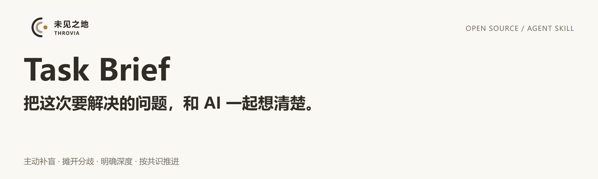
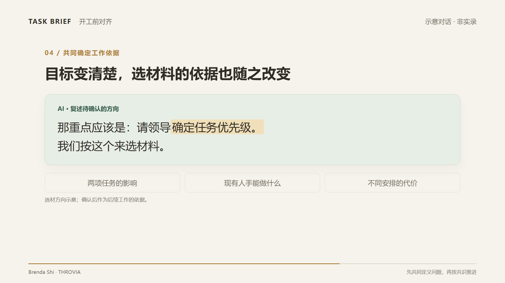

<p align="center">
  
</p>

<p align="center"><a href="#why">核心价值</a> · <a href="#demo">看 Demo</a> · <a href="#start">快速开始</a> · <a href="#examples">示范案例</a> · <a href="#faq">常见问题</a> · <a href="README.md">English</a></p>

你知道想做一件事，但“为什么做、先解决什么、这次做到哪一步”还没完全想清楚。Task Brief 让 AI 参与这个判断：检查遗漏和做法，讲明理解差异，再与你确定当前任务的目标、范围与完成标准。

**Open-source skill** · **Codex · Claude Code** · **支持 Skills 的 AI 工具** · **MIT · skill & documentation**

<a id="why"></a>

## AI 也参与判断，该解决什么问题

Task Brief 的作用，是把共同判断、处理分歧和沿用共识写成可复用规则，而不是把澄清工作全部交给用户。

| 规则重心 | 期望看到的具体行为 |
| --- | --- |
| AI 主动补盲 | 检查遗漏与做法是否服务目标；发现问题时解释影响并提出建议。 |
| 显式处理分歧 | 区分“你的要求”“AI 的理解”及两者差异，让选择可以被讨论。 |
| 校准工作颗粒度 | 明确针对什么对象、做到多深、在哪个阶段停止，以及交付什么。 |
| 对齐要有效推进 | 每轮消除关键不确定性、解决分歧或取得必要确认；最多四轮，保留未决事项。 |
| 让共识约束后续 | 沿用已确认的方向；有变化时明确说明并更新，只推进清楚且获授权的部分。 |

<details open>
<summary>我们希望 AI 承担的完整责任</summary>

AI 也要承担定义问题的责任：主动发现盲点、检查提出的做法是否对准目标，把双方的理解差异和关键分歧摊开，与人共同确定当前该解决的问题、做到什么程度，并让已经达成的共识成为后续推进的依据。

</details>

<a id="demo"></a>

## 从“做 PPT”，到确定这次汇报要促成什么

[](https://github.com/THROVIA/Task_Brief/raw/refs/heads/main/assets/demo/task-brief-zh.mp4)

示意对话 · 中文 · 无配音。点击封面打开 MP4。

<details open>
<summary>阅读四句示意对话</summary>

**你：** 帮我做一份项目汇报 PPT。

**AI：** 材料里提到团队人员不足，这次目的是补充人员吗？

**你：** 领导可能不批准。但我需要领导确认：两项任务先保哪项。

**AI：** 那重点应该是：请领导确定任务优先级。我们按这个来选材料。

</details>

**01 / 提出判断 · AI 不只等你补信息**

把“缺人 → 申请人手”的假设说出来，让你能够确认或修正。

**02 / 显露差异 · 共同确定当前问题**

用户补充真实约束：眼下需要领导决定任务优先级。

**03 / 影响下一步 · 共识成为工作依据**

确认这个方向后，选材应围绕任务影响、人手与取舍。

这个示例展示问题理解怎样变化；它没有证明模型一定会发现盲点，也没有展示汇报后的业务效果。

<a id="start"></a>

## 开始使用

### 1. 安装到你使用的 AI 工具

选择下方工具。[Skills CLI](https://github.com/vercel-labs/skills) 需要 Node.js 22.20 或更新版本。命令中的 `-g` 表示个人安装；只在当前项目使用时去掉它。

<details open>
<summary>Codex</summary>

```sh
npx skills add THROVIA/Task_Brief --skill task-brief -a codex -g
```

在 Codex CLI 或 IDE 扩展中，通过 `/skills` 选择，或在输入中使用 `$task-brief`。

[官方 Skill 文档](https://learn.chatgpt.com/docs/build-skills)

</details>

<details open>
<summary>Claude Code</summary>

```sh
npx skills add THROVIA/Task_Brief --skill task-brief -a claude-code -g
```

在 Claude Code 对话中输入 `/task-brief`。

[官方 Skill 文档](https://code.claude.com/docs/en/skills)

</details>

<details>
<summary>Cursor</summary>

```sh
npx skills add THROVIA/Task_Brief --skill task-brief -a cursor -g
```

在 Agent 对话中输入 `/task-brief`，或通过 `@` 选择。本地安装不会自动提供给远程工作环境；Cloud Agents 需同步个人 Skill 或使用项目内的 Skill。

[官方 Skill 文档](https://cursor.com/help/customization/skills)

</details>

<details>
<summary>Gemini CLI</summary>

```sh
npx skills add THROVIA/Task_Brief --skill task-brief -a gemini-cli -g
```

运行 `/skills reload`，再用 `/skills list` 查看。说明“请使用 task-brief 处理这个任务”，并按提示授权启用。此方式适用于 Gemini CLI，不是 Gemini 网页聊天。

[官方 Skill 文档](https://geminicli.com/docs/cli/using-agent-skills/)

</details>

<details>
<summary>OpenCode</summary>

```sh
npx skills add THROVIA/Task_Brief --skill task-brief -a opencode -g
```

在任务开头要求加载 `task-brief`。Skill 的发现和读取受 OpenCode 权限配置影响。

[官方 Skill 文档](https://opencode.ai/docs/skills/)

</details>

Cursor、Gemini CLI、OpenCode 的方式依据各自 Skill 文档提供，尚未完成 Task Brief 在这三个客户端的端到端验证；加载和执行表现可能随客户端版本、模型而变化。

<details>
<summary>手动安装与其他工具</summary>

下载 <SKILL.md>，保留文件名和开头的元数据，放到对应路径。`~` 表示你的用户主目录。

| 工具 | 个人安装路径 |
| --- | --- |
| Codex | `~/.agents/skills/task-brief/SKILL.md` |
| Claude Code | `~/.claude/skills/task-brief/SKILL.md` |
| Cursor | `~/.cursor/skills/task-brief/SKILL.md` |
| Gemini CLI | `~/.gemini/skills/task-brief/SKILL.md` |
| OpenCode | `~/.config/opencode/skills/task-brief/SKILL.md` |

重新打开客户端，或刷新其 Skill 列表。更多工具可在 [Skills CLI 支持列表](https://github.com/vercel-labs/skills/blob/main/docs/agents.md) 中查找对应的安装目标。

</details>

### 2. 带上你正在做的任务

调用 Skill 后，可以这样开始：

```
我要做一份给领导看的项目汇报 PPT。
目前有两项任务要推进，人手不够。
请帮我一起判断这次汇报要解决什么，
再和我确定该选哪些材料。
```

已经确认的方向也一起告诉 AI。观察它是否发现了影响下一步的遗漏或取舍，是否把任务说得更清楚，并沿用你已经作出的决定。

<a id="examples"></a>

## 示范案例

以下为示意场景，可替换成你正在处理的任务。

### 开发：做一个报名页面

“帮我做一个志愿者报名页面，免费，最多 30 人。”

提交即占名额，还是审核通过才算报名成功？这个决定会改变页面流程、报名状态，以及名额用完后的处理。

先确定名额与审核规则，再决定表单怎么做。

### 分析：为什么咨询变少了

“帮我分析近三个月的咨询记录，有些来源标签缺失。”

这次要决定往哪个渠道投入，还是查咨询在哪一步流失？来源标签缺失，会影响能否判断渠道表现。

先确定分析要支持的决定，以及现有记录能回答到什么程度。

### 传播：改进产品页面

“把这个产品页面改得更有说服力。”

给谁看，希望读者下一步做什么？面向陌生访客的介绍，与面向熟悉产品的用户，需要不同的内容。

先确定读者与期望动作，再调整文案和展示顺序。

<a id="faq"></a>

## 常见问题

<details open>
<summary>与 grill-me、brainstorming 有什么区别？</summary>

三者都帮助你在行动前想清楚问题，可以按这次讨论要产出什么来选择。

| Skill | 你现在希望…… | 主要侧重点 |
| --- | --- | --- |
| [grill-me / grilling](https://github.com/mattpocock/skills/tree/main/skills/productivity/grill-me) | 深入检查一个计划或决定。 | 按决策依赖组织多轮访谈，逐步覆盖决策树，再确认共同理解。 |
| [superpowers brainstorming](https://github.com/obra/superpowers/blob/main/skills/brainstorming/SKILL.md) | 把想法发展成设计。 | 通过提问、复述及必要的可视化探索意图；按任务规模形成聊天描述或设计文档，经认可后推进。 |
| **Task Brief** | 确定当前该解决什么、这一轮做到哪里。 | 明确处理补盲、分歧、工作深度与已有决定；检查讨论是否推进，最多四轮后保留未决事项并收敛。 |

这里比较的是规则侧重点，不代表其他 Skill 没有相近能力。可查看 [grilling](https://github.com/mattpocock/skills/blob/main/skills/productivity/grilling/SKILL.md) 与 [brainstorming](https://github.com/obra/superpowers/blob/main/skills/brainstorming/SKILL.md) 的原文。

</details>

<details>
<summary>每个任务都要先问一轮吗？</summary>

简单明确的任务可以直接做。对话里已经有的决定，应当沿用。需要讨论时，每轮都应解决影响下一步的问题；最多四轮后总结共识与未决事项，只继续清楚且获授权的部分。

</details>

<details>
<summary>AI 会替我决定应该做什么吗？</summary>

最终决定权在你。AI 应说明某种做法为什么可能偏离目标、有哪些取舍，并提出建议。除非你接受或已授权它选择，否则建议不能当成你的决定。

</details>

<details>
<summary>普通 AI 聊天也能用吗？</summary>

可以。把 <SKILL.md> 中的规则粘贴到对话里，要求 AI 按规则处理当前任务。这是给当前对话提供指令，并不等于原生安装了 Skill；如果工具提供 Skill 导入功能，应按该工具的方式操作。表现仍取决于模型和上下文。

</details>

<details>
<summary>能接着用其他 Skill，或者换个对话继续吗？</summary>

可以把共同确定的任务、范围、交付、完成标准和未决事项交给下一个工作流程，并要求沿用已有决定，只补充新的问题。换到新对话时，需要你带上这份定义；Task Brief 不会自动创建跨对话记忆。

</details>

<a id="feedback"></a>

## 告诉我们，哪一步帮到了你

AI 是否发现了你没想到的问题、摊开了分歧，或帮助你确定了下一步？欢迎分享一段脱敏对话。重复提问、误解目标，也值得告诉我们。

- [反馈使用情况](https://github.com/THROVIA/Task_Brief/issues)：附上任务、相关回复，以及它怎样影响了下一步。
- [Star 项目](https://github.com/THROVIA/Task_Brief)，方便需要时回来使用。
- [关注 Brenda / THROVIA](https://x.com/brenda_50555)，了解人机协作案例与项目进展。

---


**Brenda Shi · THROVIA**

发布方：上海未见之地科技有限公司。

[SKILL.md](SKILL.md) · [Changelog](CHANGELOG.md) · [MIT License](LICENSE) · [Brand usage](BRAND_USAGE.md)

Skill 指令及文档采用 MIT 许可；名称、Logo 和品牌图片的使用范围见品牌说明。

Copyright (c) 2026 Brenda Shi · THROVIA.
